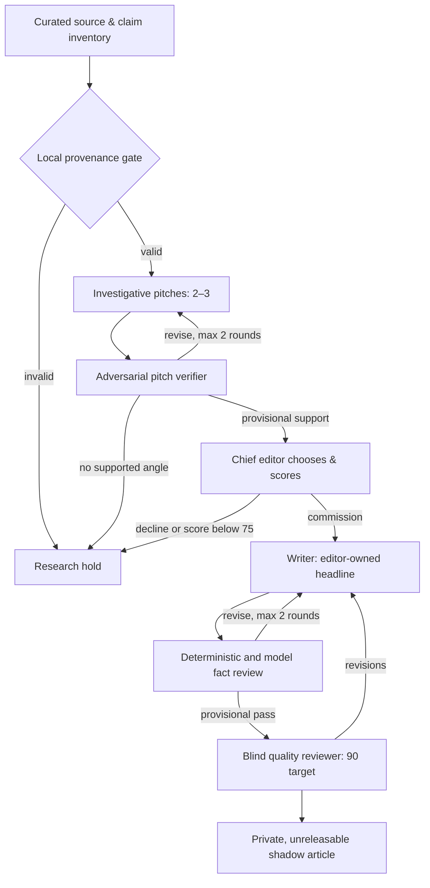

# Agentic shadow newsroom — executable editorial loop v1

**Implemented:** bounded investigator → verifier → chief editor → writer →
paragraph verifier → quality reviewer, structured model adapter, reproducible
replay, evidence-contract gates, revision feedback, SHA-256 trace and private
Markdown/JSON reports. **Publication is impossible through this command.**

**Not implemented:** autonomous article-source collection, reliable verified
full-text access, independent human semantic fact checks, real reader feedback,
or credible empirical certification of 90/100 narrative value. An LLM can
grade another LLM's prose, but that is not independent ground truth.

## The important distinction

- **Real-source replay:** uses a manually researched as-of evidence packet
  with documented URLs and short captured excerpts; the investigator/editor
  responses and article are recordings of curated work. This tests mechanics
  and review gates without creating original reporting.
- **Opt-in model mode:** the same stage choreography calls the OpenAI Responses
  API with role-specific instructions and strict JSON schemas. It may generate
  new *story pitches* and prose from the **same pre-curated evidence**; it
  cannot acquire new sources or declare truth merely by saying "verified."
- **Independent newsroom evaluation:** blind reviews from external people,
  actual source-by-source semantic review and audience outcomes. This remains
  a future, separately measured experiment. We never report process coverage
  as proof that a newspaper article is compelling or correct.

## Stage transitions



Every model stage receives a role-specific instruction, structured input,
strict JSON output schema and a global bounded call count. The verifier sees
raw source captures/claims separately from the investigator's requested
outcome. The writer receives the editor's immutable chosen headline. Review
feedback goes back explicitly; no free-form agent-to-agent conversation can
silently expand authority or run indefinitely. A failed model request,
unrecognized claim, citation gap or missing review yields a hold.

## Role contracts

| Desk | Input | Must output | Fail-closed trigger |
| --- | --- | --- | --- |
| Investigator | Dated source excerpts, claims, questions, verifier notes | Two or three distinct pitches, prior view, public stakes, counterevidence, original value | No supported news spine, no alternatives |
| Pitch verifier | Pitches, exact excerpts, source origins | Accept/revise/reject and precise follow-up requests **for every pitch** | Missing review, unsupported ID or absent counterpoint |
| Chief editor | Provisionally accepted angles and rubric | One selected ID, editor-owned headline, rationale, scored dimensions | Non-story headline, unlisted angle or provisional score below 75 |
| Writer | Selected story, evidence, revision notes | Newspaper paragraphs with claim and source links | Invented quote, unsupported ID, swapped headline, fabricated market move |
| Paragraph fact verifier | Draft and independent claim inventory | Verdict for **every paragraph** with issue descriptions | Any missing paragraph, unsupported assertion flagged |
| Blind quality reviewer | Article and background, *without previous quality ratings* | Narrative rubric and specific critique | Score below 90, any substantive request, or decline |
| Release | Human semantic audit and explicit owner permission | **Not connected** | Always holds |

The chief editor and quality reviewer use a seven-dimension weighted rubric:
20 central conflict, 20 public significance, 15 surprise, 15 specificity,
15 evidence, 10 original value, 5 narrative depth. Neither score is a
validated assessment until calibrated against independent reviewers. A score
of 90 can permit an internal *provisional shadow* pass, never publication.

## Run

```bash
# No credentials or network required; replay of curated sources + editorial work.
python -m marketsignal shadow-loop \
  --mode replay \
  --case tests/fixtures/fictional_field_trial.json \
  --out reports/editorial-loop-fictional.md \
  --trace reports/editorial-loop-fictional.json

# The real-topic Texas input stays locally ignored in data/private/.
python -m marketsignal shadow-loop \
  --mode replay \
  --case data/private/texas_senate_2026_election_day.json \
  --out reports/editorial-loop-texas.md \
  --trace reports/editorial-loop-texas.json

# Paid inference is EXPLICIT, requires a configured OPENAI_API_KEY.
# Never put the API key in flags, source JSON, GitHub files or URLs.
python -m marketsignal shadow-loop \
  --mode openai --model gpt-5-mini \
  --case data/private/your_curated_case.json \
  --out reports/model-run.md --trace reports/model-run.json
```

The script does not check for a key or make network requests in `replay`
mode. In `openai` mode, the Responses API URL is fixed, requests are capped,
structured JSON is required, outputs are not stored by the provider using
`store=false`, and failures do not print raw provider responses or private
source contents. **Inference can incur costs.** The default two investigation
and two writing rounds, 14 calls total and 55 KB stage-input ceiling are
prototype safety bounds, not a dollar-denominated guarantee. Configure
provider-account limits separately before using paid mode.

Output destinations are restricted to ignored private or report folders;
the command cannot write generated prose into the public `site/` tree.
The JSON trace hashes stage inputs and outputs, records which desks ran and
stores feedback alongside the **private** draft. It is not a public audit feed.

## First real-topic replay: November 3 Texas Senate shadow

The initial source packet included Texas Secretary of State releases, a
University of Texas polling tracker, AP and Texas Tribune reporting and one
archive *price snapshot*. No qualifying Polymarket movement was recorded;
this is a manually commissioned real-topic example, **not** proof that
quantitative triage found this story.

| Metric | Recorded result | What it proves |
| --- | ---: | --- |
| Investigator pitches | 3 | Alternatives exist in the replay |
| Selected story | Texas Republican political power and the costly Senate challenge | Editor-owned narrative spine |
| Structured desk calls | 9 | Two writing/quality iterations exercised |
| Mechanical process coverage | 100/100 | Ten observed handoff/safety checks passed |
| Provisional chief editor rating | 82/100 | A scripted editorial judgment, **not independent** |
| Provisional article-quality rating | 75/100 | Scripted skeptical baseline only |
| Independent factual accuracy | Not measured | No external sentence-by-sentence verification |
| Real reader quality | Not measured | No audience outcomes |
| Release | **HELD** | Cannot publish |

The 75/100 score is deliberately below our 90 target. Its major weakness is
**insufficient independently reported value**: citing strong AP/Tribune work
does not make our synthesis original. Better prompts alone cannot solve that
without new source access, reporting, and independent review.

## What the tests are designed to catch

The adversarial tests force investigator/verifier disagreement; ensure that
revision notes reach the next pass; reject nonexistent claim IDs, weak evidence,
unmatched printed quotes, a writer-owned change of headline, fabricated market
movement, missing verifier coverage, inflated rubrics and missing credentials.
The process continues safely under source-embedded instruction attacks and
call-budget exhaustion. These tests measure *contracts*, not truth or taste.

## Explicit follow-on milestones

1. Connect licensed/approved source acquisition and a source-content ledger
   with access dates, licensing and canonical publisher deduplication. The
   current GDELT adapter is **lead discovery**, not article-content capture.
2. Run the opt-in model version against several actual signals once a valid
   model credential and allowed provider network route exist.
3. Independently annotate accuracy and news value of at least 10 varied
   drafts (including spiked cases). Compare model and human scores before
   optimizing prompts, models or thresholds.
4. Capture reader feedback and use the supervised news-ranker challenger
   only when labels represent real outcomes, not synthetic-panel preferences.
5. Continue the owner's manual release gate; no autonomous publication merely
   because a rubric or LLM says 90.
