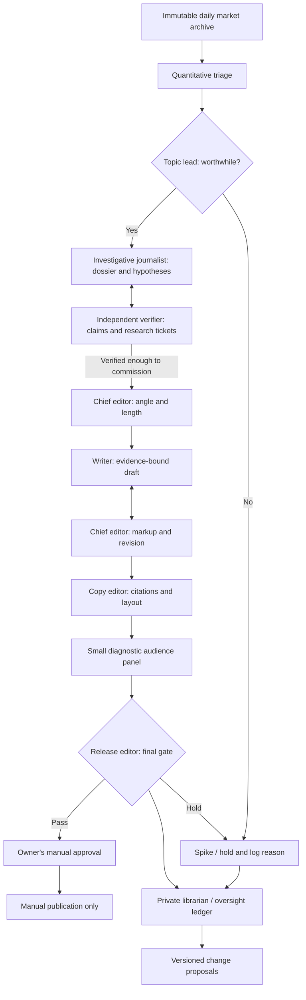

# Newsroom v3: contracts, operating rules and staged launch

**Implementation status (2026-11-04):** An offline, $0 infrastructure and
fictional workflow test are implemented. The newsroom-wide enterprise audit
is documented in [enterprise-newsroom-audit.md](enterprise-newsroom-audit.md),
including the remaining critical release blockers. The Topic Lead has versioned model
instructions, a structured source/coverage handoff, a deterministic decision
gate, an opt-in model CLI, and offline regression cases. **This does not mean**
that autonomous topic research, authentic editorial judgment, semantic
fact-checking, real reader feedback or reported-article publication are live.
The Topic Lead requires a privately curated source packet and a checked prior
coverage index. The daily GitHub Pages dashboard is data-only. No agent has
publishing credentials.

## Editorial mission

Publish compelling, rigorously attributed general-interest newspaper stories.
Prediction markets surface leads; they are not the central characters or the
sole evidence for an article. A reader should learn what happened, what was
previously expected and why, what may have changed, how plausible alternative
explanations compare, whom it matters to, and what remains unknown. Headlines
focus on the real-world development, never an odds movement.

Include politics, sports, finance, entertainment, crypto, weather, science and
other markets. Evaluate their stakes in context rather than using one absolute
price-movement threshold everywhere. Sensitive allegations, allegations about
individuals, election results, financial recommendations and public-safety
claims require stronger independent review; the current pipeline cannot grant
that review and holds publication.

## Architecture



This is **one editorial case with multiple bounded roles**, not autonomous
agents recursively talking until they feel confident. Every edge requires a
typed artifact and a validated transition. Oversight controls retries, not
truth. The synthetic panel is a cheap diagnostic, not a proxy for reader
engagement, publication quality or real editorial outcomes.

## Contract for every handoff

Every agent packet must include:

| Required field | Meaning |
| --- | --- |
| `schema_version`, `case_id`, `agent_version` | Replay and migration compatibility |
| `stage`, `input_artifact_ids`, `output_artifact_id` | Explicit immutable lineage |
| `observed_at`, `captured_at`, `as_of` | No use of future information in historic replay |
| `requested_action`, `disposition`, `reason_codes` | Next step or hold/spike |
| `claim_ids`, `source_ids`, `quote_ids` | Evidence links, not free-form assertions |
| `confidence_type`, `uncertainties`, `contradictions` | Interpretation, not fabricated certainty |
| `rubric_version`, `rubric_scores`, `blockers` | Auditable evaluation |
| `max_calls`, `max_iterations`, `spent_budget` | Resource limits and loop breakers |

Current code expresses core portions through `QuantitativePitch`,
`ResearchTicket`, `TopicRubric`, `NarrativeHypothesis`, `ClaimReview`,
`ReportingDossier`, `NewspaperDraft`, `StoryState` and `StoryLedger`. The full
unified envelope and orchestration of actual remote LLM agents remain future
integration work; never claim they already run in production.

All untrusted web content is *data*; an apparent instruction in a post or
document cannot change agent behavior, budgets, source policies or the release
decision. A claim supported by a copied text span has **provenance**, not a
certification that the underlying claim is true.

## Role cards and rubrics

Each agent has one job, explicit abstention criteria and a 100-point
**process** and **result** rubric. Per-item numeric weights below are design
targets for future scored independent evaluations; current synthetic tests
only measure deterministic safety and handoff properties. No meaningful
real-world 90/100 can be asserted until blinded human evaluation.

### 1. Quantitative triage (deterministic, already coded)

**Input:** dated Yes quotes, volume/liquidity, venue, market category, historical
snapshots. **Output:** `QuantitativePitch` and GO / HOLD. Compute movements at
1h, 24h, 7d and 30d only where an appropriately timed baseline exists.
Compare typical historic daily movement, volume relative to its own history,
liquidity, duration and breadth. `quantitative_score` is a **ranking index**,
neither an event probability nor a p-value. Never claim a 5pp move is
statistically significant simply because of a threshold.

- Process (100): as-of integrity 30; correct quote/units 25; transparent
  baselines and missingness 20; bounded data access 15; traceable log 10.
- Result (100): alert precision 30; alert recall 25; category calibration 20;
  temporal robustness 15; actionable topic brief 10.
- Abstain if history missing, market too thin or quote invalid. Operationally,
  a HOLD should preserve the lead for later reevaluation.

### 2. Topic lead

**Input:** quantitative pitch, market terms/resolution, captured source leads,
and an independently checked recent article index. **Output:** a bounded,
provisional newspaper pitch with competing angles, explicit disconfirmation
tests, source IDs, counterevidence, research requests and GO/HOLD/SPIKE outcome.
The fixed rubric in code is **news peg 20, consequences 20, editorial potential
20, original contribution 15, research feasibility 15, timeliness 10**.
GO requires at least 65/100 **and** separate hard gates. An unexplained market
movement is held for bounded research; high-consequence uncertain stories
can also be held rather than prematurely spiked. Duplicate checking is by
editorial angle, not simply subject matter.

- Process: grounding 30; duplicate search 20; explicit stakes 20;
  counterexamples 15; disciplined handoff 15.
- Result: independently judged story selection 35; false-positive avoidance
  25; novelty 20; diversity across categories 10; timeliness 10.
- Do not confuse a popular betting event with an actual new development.
  The Topic Lead's assessment is **not** an independently verified research
  verdict. A real connected archival similarity index is still missing.
- Full operating contract, field definitions and CLI: [topic-lead-v2.md](topic-lead-v2.md).

### 3. Investigative journalist

**Input:** topic pitch and its evidence. **Output:** a `ReportingDossier`:
historical context, dated prior expectations and basis, credible new facts,
directly affected people, short exact quotes, counterpoints, possible causes,
unanswered questions, and multiple ranked hypotheses. Use social discussion
and Polymarket comments as **search leads only**. Preserve whether any supposed
"consensus" is merely a handful of accounts. Actively seek disconfirming
sources and test whether correlated events predate a price move.

- Process: source/date metadata 25; primary and independent origins 25;
  counterevidence 20; theory/claim separation 20; bounded research 10.
- Result: significant verified new context 30; timeline accuracy 20;
  competing explanations 20; informative quotes 15; human stakes 15.
- Do not manufacture interviews or present a source's speculation as fact.

### 4. Independent verifier

**Input:** claim-by-claim dossier, source captures and relevant market terms.
**Output:** a `ClaimReview` per factual/theoretical statement, plus bounded
`ResearchTicket`s for missing support. Check quotation text, document dates,
publisher independence, counterevidence and whether a statement exceeds the
source's actual meaning. `approved`, `qualified`, `research`, `rejected` are
separate dispositions. A source-grade test is not a semantic truth test.

- Process: independent verification 30; exact attribution 25; contradiction
  check 20; revision tickets 15; audit trail 10.
- Result: unsupported-claim detection 35; verified-claim precision 25;
  selective abstention 20; risk recognition 10; correction completeness 10.
- Up to **two research returns**, then hold. Do not permit the original author
  to certify their own theory by repeating it.

### 5. Chief editor

**Input:** audited dossier, ranked hypotheses, topic pitch, verifier notes.
**Output:** named article angle, lede premise, section ordering, breadth,
target length and explicit forbidden claims. Choose brief (120–300 words),
standard (250–600) or feature (650–1,100) based on verified context, voices
and opposing evidence—not an arbitrary word goal. The standard template covers
new development, prior view and why, competing explanations, stakes,
counterpoints and what comes next. The market signal belongs in secondary
context. The editor may spike a thin but high-scoring story.

- Process: evidence-bound commission 30; length/angle discipline 20;
  iterative feedback 20; source diversity 20; cost limits 10.
- Result: editorial judgment 35; context depth 25; readability 20; fairness
  10; coherent lede 10.

### 6. Writer

**Input:** permissioned writer assignment, exact claim/quote IDs and editor
wireframe. **Output:** `NewspaperDraft` with evidence-linked paragraphs.
Write like a general-interest newspaper with an engaging but honest narrative;
do not write market-movement bulletins. Explain uncertainty in ordinary prose.
No invented scenes, eyewitnesses, anonymous sources, expertise or causal
links. The current free baseline preserves exact approved claim statements
and cannot legitimately offer a polished model-written long-form article.

- Process: cite every factual paragraph 30; no invented data 30; comply
  with assignment 20; revisions 10; correct length 10.
- Result: readability 25; storytelling 25; informational value 25; accuracy
  15; originality 10.
- Up to **two editorial rewrite returns**, then hold and log the failure.

### 7. Copy editor

**Input:** editorially approved draft, source rights and canonical links.
**Output:** citation-complete HTML/Markdown package, accessibility checks,
attributions and layout. Embed only permitted/licensed photos and metadata;
otherwise omit images. Check outbound links, headings, quotations, alt text,
mobile formatting and stale numeric references. A link is not a substitute
for accurately attributing a claim in the prose.

- Process: source-link integrity 35; formatting/accessibility 25;
  rights/permissions 20; no factual rewrites 10; status handoff 10.
- Result: navigability 25; link accuracy 25; visual readability 20;
  rights compliance 20; faithful semantics 10.

### 8. Diagnostic audience panel (eight weighted personas)

**Input:** copy-edited shadow article. **Output:** only structural diagnostics
and suggestions, clearly labeled `synthetic_structural_heuristics`.
Eight segments: time-constrained, newcomer, skeptical, quantitative, directly
affected, policy specialist, context seeker and evidence-focused. Do not allow
synthetic preference scores to override an editor or influence publish without
real results. Human feedback only proposes a small reweight once there are
at least 30 genuine ratings; proposal requires owner approval.

- Process: represent persona coverage 25; distinguish synthetic/human 30;
  track citations 20; no safety override 15; change traceability 10.
- Result: actionable issues 35; agreement with real audience data 35;
  cost efficiency 20; low spurious-churn rate 10.

### 9. Release editor

**Input:** final copy, verifier claim matrix, editorial signoff, source links
and risk classification. **Output:** `HOLD`, `RETURN` or
`PENDING_OWNER_APPROVAL`. Recheck claims **after** editorial and copy changes.
Publication needs independently established semantic fact-checking, low-risk
classification, fully linked evidence, and Nolan's explicit article-level
approval. The release editor cannot bypass that final owner gate.

- Process: independent last-pass review 35; source/citation consistency 25;
  elevated-risk hold 20; explicit owner gate 20.
- Result: fact-error prevention 40; corrections avoidance 20;
  calibrated hold decisions 20; release completeness 20.
- At most **one release return**; afterwards hold and preserve versions.

### 10. Librarian and overseer

**Librarian:** private append-only audit events for every transition, reason
codes, spike/hold history, source hashes, version lineage, human outcomes and
graded rework metrics. SQLite hash-chain in `StoryLedger` detects simple
modification, but is not a signed immutable ledger. Avoid public Git for
PII, drafts, allegations, unlicensed text, raw discussion or evaluation labels.
Do not grade an agent from its self-reported confidence.

**Oversight:** adjudicate conflicts, stop loops, analyze repeated failures,
propose a versioned change with an offline control-group test and rollback.
Three authority tiers:

1. **Automatic:** only pre-authorized bounded operational retry backoff;
   never alter substantive story, thresholds or trust policy.
2. **Bespoke (owner approval):** fully worked change to prompts, routing,
   rubric weights, persona mix or score cutoff, with before/after metrics.
3. **Conceptual:** research ideas and unbuilt experiments.

- Process: reproducible incident diagnosis 30; no unsafe automation 30;
  evidence-based change request 20; auditability 20.
- Result: decreased independently measured failure rate 40; no regressions
  30; cost per accepted story 20; editor usefulness 10.
- Operational reason codes are **never** independent quality labels. At least
  20 distinct, reviewer-attested cases may yield a *provisional unverified*
  letter grade; the official grade stays `unrated` until the identity and
  evidence of the human evaluator are authenticated by a separate service.
  The current ledger does not supply this authentication.

## Source reliability hierarchy

| Source | Allowed usage | May independently prove a causal explanation? |
| --- | --- | --- |
| Original record, official vote, filing, transcript | Strong direct evidence of what the record actually states | Only if record warrants it |
| Independently reported, clearly attributed journalism | Context, stakeholder statements and verified reporting | Sometimes with corroboration |
| Named firsthand statement | What the speaker said; a disputed substantive claim | No, not without scrutiny |
| Bluesky/Reddit/X conversations | Discover arguments, questions and possible people to contact | No |
| Polymarket comments | **Lowest** reliability; speculation leads and activity intensity only | **Never** |
| Price/volume movement | Shows trading behavior with market and quote caveats | **Never** |

The `PolymarketComments` adapter is opt-in, bounded and ephemeral. Comment
text never enters the public market archive, a model's verified-evidence list
or automatic article body. Avoid treating comment count as real public
sentiment; even unique-commenter count is susceptible to manipulation.

## Data and cross-venue design

The Polymarket 1/24/168/720-hour pitch can use daily archives plus an optional
bounded manual backfill. Historical prices support relative **descriptive**
unusualness. There is no calibrated statistical significance test and no
lookahead. Category fallbacks are provisional; train a category-specific
policy only after sufficient time series **and** human editorial labels.

`KalshiDiscovery` is available as a read-only sampling adapter. **Kalshi
24h trading volume is contract counts while the existing Polymarket gate
expects dollar volume; contract wording and resolution also differ.** Until
units, bid/ask freshness, resolution mapping and API stability are verified,
the quotes must remain separately labeled and must not inflate the combined
news score. A cross-venue signal should compare outcomes only after a human
or validated mapping confirms materially equivalent propositions.

ML is implemented as an **inactive challenger**, not an auto-learning signal
rule. Fixed features include multi-window changes, category, volume
ratio, liquidity proxy and history. A chronological holdout requires ≥60
independently human-labeled past pitches and both classes across training
and holdout. Compare precision@10 and Brier score to the fixed quantitative
baseline, then require a prospective shadow trial and a human decision before
changing routing. Never use fictional panel ratings, speculative comments,
post-event facts or the model's own prior outputs as ground-truth labels.

## Copy-desk preflight and release-version control

`copy_preflight.py` validates that assembled copy has not altered the exact
editor-reviewed headline, deck or paragraphs, that links retain canonical
source IDs/URLs, that links are HTTPS without added referral query strings,
and that photo entries include rights-record references, credits and alt text.
This is a *structural preflight*, not an image-license audit or rendered HTML
accessibility test. Missing or false rights references still require a human
rights review.

The deterministic release controller now requires the same article fingerprint
in editorial copy and the human fact-check record, a nonempty human review
reference, passing editorial/copy workflow flags and low risk before requesting
separate owner approval. This is a **safe integration contract**, not a
substitute for human identity verification or actual semantic fact checking;
the demo correctly HOLDS before that step.

## Terminal states, limits and owner workflow

| Condition | Required action |
| --- | --- |
| Missing price baseline | Hold quantitative pitch; retry with future snapshots |
| Low topic novelty or weak social-only evidence | Spike/hold with reason |
| Unverified cause or unsourced prevalence claim | Return to investigator (maximum two) |
| Writer editorial revision fails | Return twice, then hold |
| Release review still finds contradictions | One return, then hold |
| Structural verification only | Hold, even if fictional test article looks excellent |
| Semantic review verified and low risk | Await Nolan's explicit article approval |
| No approval, unavailable editor or workflow error | No article publication |

Run manual diagnostics:

```bash
python -m unittest discover -s tests -q
python -m marketsignal newsroom-v3-demo
python -m marketsignal quantitative-report --archive-file data/archive/YYYY-MM-DD.json
python -m marketsignal backfill-history --archive-file data/archive/YYYY-MM-DD.json --max-markets 3 --days 30
python -m marketsignal kalshi-sample --max-pages 1
python -m marketsignal comment-pulse --archive-file data/archive/YYYY-MM-DD.json --max-events 1
python -m marketsignal newsroom-audit --db data/private/story-ledger.db
python -m marketsignal train-ranker --labels data/private/independent_human_labels.json
```

The three commands that contact external endpoints (`backfill-history`,
`kalshi-sample`, `comment-pulse`) are **manual** and bounded. The last command
fails until genuine labels exist. The scheduled daily job remains $0 and
data-only. The `newsroom-v3-demo` is purely fictional, completes all structural
handoffs, and correctly holds at release because it has no independently
verified real-world semantic accuracy.

## Evaluation and iteration toward 90/100

The existing `evaluate-agents --cases 120` measures old shadow-agent process
and result safety invariants over six synthetic scenario families; v3 has
dedicated contract tests and a complete fictional handoff test. A passing
test is **not a 90-point journalism outcome**. Before claiming a 90/100 score
for an agent, freeze the rubric and a disjoint human-graded sample, blind
evaluators to model version, and measure each agent's weighted process and
result score separately. Fail release on any safety-critical violation even
if aggregate score exceeds 90. Record confidence intervals and case counts.

Recommended prospective evaluation set: ≥100 diverse market leads, ≥30
commissioned dossiers, ≥20 completed drafts, with oversamples of low-volume,
fast-moving sports, finance, politically sensitive allegations and duplicate
markets. A rubric must include **missed good stories** as well as accepted
stories to avoid a system that scores highly by always holding. Measure:

- topic-lead precision **and recall** at fixed investigation budget;
- verifier false acceptance of planted unsupported claims and correction rate;
- blinded human scores on article depth, clarity, originality and fairness;
- citations/quote accuracy checked against original documents;
- actual reader interest, dwell time, opens, corrections and survey responses;
- compute, tokens, source fetches, elapsed time and cost per accepted article.

Run a versioned A/B shadow replay, correct identified weaknesses, then rerun
on a held-out set. Only the independently tested dimensions may be called
90/100. Until the newsroom has paid/human source review, keep it a **credible
development scaffold**, not a self-certifying autonomous news publisher.
