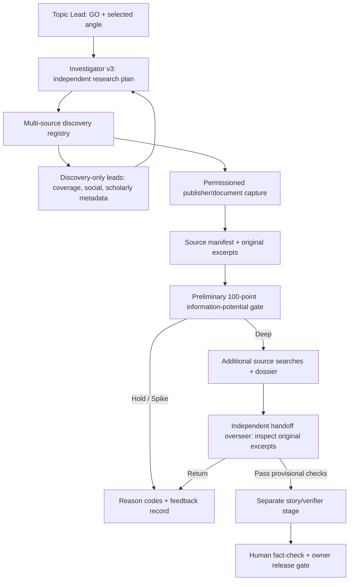

# MarketSignal public-source retrieval and handoff oversight — v1 mock

**Status (2026-11-04):** a real, typed read-only retrieval *mechanism* and
source registry exist; the complete external source portfolio is **not** live.
The existing fictional newsroom replay now invokes Investigator v3 and a
separate pre-verifier overseer. The replay, model and source responses remain
scripted. No paid API, Reddit/X account, external publishing, or human review
was invoked in this test.

## Operating model



The prior Topic Lead assignment is not a story thesis to be defended. It is a
research question, relevant source seeds and a prior-coverage baseline. Only
captured permitted documents can substantiate material claims. Retrieved
titles, search snippets, social posts and market comments are **discovery
leads**, not fact verification. Even source-backed claims remain provisional
until independent semantic and editorial review.

## Source portfolio and initial priority

| Tier | Category | Discovery/capture method | Status | Journalistic purpose |
|---|---|---|---|---|
| P0 | Government, regulators, official bodies, local governments | Configured RSS/Atom feed search → approved primary-document host capture | Implemented, feed/host configuration required | Firsthand records, changes to rules, decisions and timelines |
| P0 | Credible journalism, national and local/specialist | GDELT news discovery → approved publisher capture | Implemented, captures require rights/robots/accessible metadata | Establish prior reporting, prevailing documented accounts, remaining original angle and counterfacts |
| P1 | Scholarly research and original studies | Crossref published-work metadata via API | Implemented **metadata-only** | Locate source studies, methods and potential false interpretations; separate full-text rights review needed |
| P1 | Bluesky conversations | Public Bluesky search | Existing adapter integrated into registry | Find eyewitness *leads*, stakeholder concerns, alternative hypotheses; not representative polling |
| P1 | Polymarket discussion | Event-specific Gamma comment pulse | Existing adapter integrated into registry | Detect conjecture and missing search terms; lowest reliability and no sentiment inference |
| P2 | X/Twitter public posts | Official recent-search API, permissioned token | Deferred pending API access and policy review | Named public statements, expert accounts, contemporaneous leads |
| P2 | Reddit discussion | Official OAuth/approved commercial access | Deferred pending access/license and retention review | Identify lived-experience leads, local issue threads and missing counterarguments |
| P2 | Court dockets, municipal portals, SEC/agency filings, public datasets | Topic-specific adapters with host policy, document parsers and dates | Catalogued, adapter work pending | Primary paper trail for higher-stakes stories |
| P2 | Research repositories/data portals, PDFs, technical reports | Permissioned adapters and a structured PDF/data verification layer | Planned | Reproducible original analysis and document-to-claim verification |

These are **source classes**, not endorsement lists. Prioritization is
story-specific: a public-health topic may need agencies and studies, while an
infrastructure dispute may prioritize city records, contractors and specialist
local reporting. A single source discovery channel must never masquerade as
complete web coverage.

### Search and document policy

1. **Identify the question and coverage baseline.** Seek the dated prior view,
   relevant source documents, the exact difference from already published
   journalism, and at least one plausible competing explanation.
2. **Search evidence upstream first.** Search registered official, reputable
   reporting and research sources. Add social/search discussions as bounded
   hypothesis routes, never as confirmed real-world facts.
3. **Preserve both positive and negative leads.** A discovered fact may rebut
   the starting story; the investigator is free to reframe or spike.
4. **Capture separately.** Only an explicitly approved publisher hostname,
   publication timestamp, robots policy and short-excerpt permission can enter
   `ResearchCapture`. No redirect following or paywall bypass; no arbitrary
   URL open or private account login.
5. **Differentiate origins.** A five-outlet syndicated article is one
   reporting origin until independently confirmed otherwise. `origin_key`
   metadata is an aid, not proven source independence.
6. **Bound the work.** The orchestrator caps investigator queries (8) and
   captures (30); fan-out caps actual provider calls (20 by default), limits
   each query to four captured documents and limits each discussion source to
   two search calls. Failures are logged by source/type, not silently dropped.
7. **Respect clocks and replay semantics.** Historical runs require captures
   available by the stated cutoff. Live-shadow runs permit a bounded 30-minute
   delay between the story cutoff and retrieval of previously published
   sources, with `captured_after_case_as_of` explicitly recorded. This does
   *not* prove a site had identical text at the earlier time; historical
   revisions require archived originals.

### Discussion and public sentiment

What social content **can** do: suggest named officials to check, eyewitness
leads, possible neglected consequences, new reporting vocabulary or a genuine
counter-hypothesis. What it **cannot** do without sampling design: establish
the population's opinion, prevalence, causal explanation, identity or truth.
High-engagement comments are often selected, coordinated or platform-specific.
Polymarket chat in particular is subject to trading incentives. Do not label
any item as verified until confirmed from a legitimate attributable source;
never surface personal account identifiers in public reports.

### Per-source credibility assessment (editorial rubric)

Do not assign a publication a permanent numeric "truth score" or treat
prestige as proof. For the **specific claim being tested**, an independent
source reviewer should grade these dimensions with `none / partial / full`
and a cited supporting passage or research record:

| Dimension | Max | Full-credit standard |
|---|---:|---|
| Direct evidentiary authority | 25 | Primary document/test/eyewitness attribution actually addresses the precise claim |
| Traceability and original origin | 20 | Original publisher, author/speaker, document date and upstream sourcing can be checked |
| Editorial accountability | 15 | Reporting makes methods, direct quotes, corrections and uncertainty inspectable where relevant |
| Independent corroboration | 20 | Material finding has independent evidence; repetition/syndication is explicitly removed |
| Temporal and contextual relevance | 10 | Source establishes what was known when, without updated-page or market-timing confusion |
| Incentives, disputes and limitations | 10 | Relevant conflicts, interested statements, missing evidence and contrary reporting are disclosed |

These are editorial instructions for review, **not** a running automated
credibility score. An editor should not disqualify a reliable official record
because it comes from an interested institution; rather, use it to establish
what that institution *did or stated*, and independently test disputed facts.
Likewise, a well-sourced local specialist outlet may be more directly
authoritative than a national summary. The handoff checker is prompted to
apply this lens, while the automated contract verifies passage provenance;
quantitative credibility calibration awaits real labeled examples.

**X:** Official search access is conditional; this repository does not bypass
access restrictions or scrape logged-in pages.
**Reddit:** Data API/terms require permitted access, restrict retention and
prohibit unapproved reuse for AI training; therefore the connector remains
disabled pending reviewed terms and use-case authorization.

## Independent research-coverage diagnostic (100 points)

Unlike story-quality scoring, this is an **operational coverage checklist**:

| Criterion | Points | Objective condition |
|---|---:|---|
| Official source search attempted | 10 | Configured primary-source adapter invoked |
| Primary record captured | 20 | At least one dated publisher-approved original record |
| Journalism search attempted | 10 | Journalism discovery adapter invoked |
| Independent reporting captured | 15 | At least one permissioned source with substantive excerpt |
| Prior coverage logged | 10 | Dated news/coverage lead inventory exists |
| Multiple captured origins | 10 | At least two distinct reported origin keys |
| Social remains non-evidentiary | 10 | Every discussion result remains a lead, not proof |
| Rights boundary | 10 | All captured materials have permitted source roles |
| Auditable attempt/error trail | 5 | Captured provider attempts and sanitized failures |
| **Total** | **100** | **A process check, not an accuracy or story-worthiness score** |

A score of 100 is **not** a source-sufficiency pass. Additional gates remain:
the intended claims require relevant documents, direct linkage, contradictory
source review and a checked novelty delta. The reviewer must examine what the
original excerpts actually say. Failed/inaccessible routes are documented, not
silently treated as negative evidence. To avoid gaming the rubric, an empty
social search cannot increase confidence in truth or public sentiment.

## Corrected separation: Contract Gateway, Verifier, Process Overseer

`HandoffContractGateway` is a **deterministic** check at the Investigator →
Verifier boundary. It checks artifact identity, source IDs, dated captures,
manifest hashes, allowed provenance, and dossier references. A source ID may
be valid while its interpretation is wrong: **that is not the Gateway's job**.
An invalid contract blocks handoff with explicit reason codes; a passing
contract authorizes only entry into the Verifier stage, not commissioning.

`EvidenceVerifier` is the **single substantive dossier-claim reviewer**. The
model adapter `ModelClaimReview` is invoked only here, after gateway success.
It independently examines original source excerpts for every finding and
returns `supported`, `contradicted`, or `insufficient`, with an exact quote and
rationale. Its provisional approval is required before the controller allows
editorial commissioning; it is **not** an authenticated human fact-check.
Paragraph-level review remains a separate later checkpoint on the *article*.

`ProcessOverseer` is an out-of-band diagnostic service: it consumes privacy-safe
events across distinct cases, identifies repeated operational/contract/model
failures, and proposes versioned experiments with a frozen control replay,
held-out regression cases, and independent quality review. It cannot check
truth, silently edit prompts/policies, relax gates, or authorize publication.
One case's repeated error is a loop diagnostic, **not** independent cross-case
evidence. This division replaces the earlier overlapping `HandoffOverseer`.

## Implemented integration and remaining gaps

- `newsroom-v3-demo`: a fictional Topic Lead GO now selects an angle, creates a
  matching source capture assignment, invokes v3's preliminary/deep stages,
  and passes through the deterministic `HandoffContractGateway` and
  `WorkflowController.advance_investigator_v3` **before** entering verification.
  A scripted `EvidenceVerifier` then runs **inside** verification, and the
  append-only ledger records both stages. The Process Overseer reads ledger
  events and returns diagnostics but never blocks a case by itself.
  The downstream feature writer still consumes its pre-existing fictional
  `ReportingDossier` fixture, **not** a conversion of the new v3 dossier.
- `MultiSourceResearchProvider`: composable, bounded search/capture across
  official feeds, GDELT, Crossref, Bluesky and Polymarket when configured.
  Official publisher contents require explicit permission policy. Unit tests
  inject in-memory feeds, API responses and page captures; real external
  provider success has **not** been measured in this version.
- `ModelClaimReview`: the dossier Verifier's structured LLM stage is prepared, but live
  semantic grading has **not** been run. The fictional demo reviewer returns
  scripted verdicts, so it cannot prove that a claim is accurately interpreted.
- `research-v3-shadow`: an **explicit opt-in** private command can run Topic
  Lead → configured public retrieval → Investigator v3 → Contract Gateway →
  provisional dossier Verifier and save a JSON diagnostic. Its input must include matching trusted
  captures and a selected angle; it does not auto-choose the story or spend
  tokens in the ordinary daily collector. No real external end-to-end run has
  been performed or validated yet. The active automated collector/daily
  publisher does **not** use the new investigative path.

Example *configuration shape* (not a recommendation to crawl any host):

```json
{
  "publishers": [
    {"host": "example.gov", "kind": "official_record", "copyright_basis": "official_public_record"},
    {"host": "publisher.example", "kind": "independent_reporting", "copyright_basis": "permissioned_short_excerpt"}
  ],
  "official_feeds": ["https://example.gov/announcements.xml"],
  "enable_bluesky": true,
  "enable_crossref": true
}
```

Replace example hosts with expressly approved, independently verified
publishers and actual permitted feeds. A live opt-in invocation is:

```bash
python -m marketsignal research-v3-shadow \
  --context-file data/private/topic-context.json \
  --captures-file data/private/captured-context.json \
  --policy-file data/private/research-policy.json \
  --angle-id approved-angle-id \
  --out data/private/investigator-v3-shadow.json
```

This requires a configured model credential, makes real public GET requests
and model calls (which may incur charges), and keeps results private. It is
**not** invoked by the tests, daily job or this report.

## Evaluation sequence before broadening the newsroom

1. Freeze this source/overseer contract and run synthetic adversarial
   examples across public-health, local government, business, science, sports
   and infrastructure topics, including social-only rumors, copied coverage,
   inaccessible records and evidence-supported spikes.
2. Wire the public adapters with a source-domain allowlist and rights inventory
   for a few real *non-midterm* cases. Run in shadow mode with all stage outputs
   private and no external outreach, publication or trading.
3. Review source recall, which real records were missed, and whether relevant
   prior journalism was actually found. Grade claim/quotation entailment and
   meaningful disconfirmation using human-reviewed examples. Tune provider
   priority based on missed source categories, not aggregate source count.
4. After a credible real test set, decide whether to extend semantic checker
   coverage, modify thresholds or optimize execution costs. Avoid treating
   structural self-score accuracy as empirical quality.
