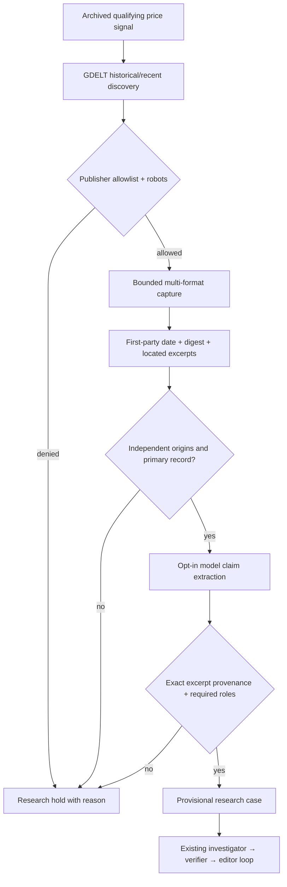

# Source capture and autonomous reporting foundations (v1)

**Status:** source-capture transport and research-case assembly implemented,
tested against an offline web/robots harness. Live independent research and
article-quality evaluation are **not certified**. No real articles are
automatically published.

## Why this is a separate layer

In the old shadow run, the investigator could only work with a source inventory
that a person had already researched. That is not an autonomous reporting
operation. A new layer now joins discovery leads to *permissioned page
captures*, short excerpts and source-linked proposed claims. It must not
silently promote a news-search result or a market comment into a fact.



### Permissions and source fidelity

- Fetches are HTTPS-only on **exact hosts** explicitly listed in the publisher
  policy, not every URL returned by GDELT. No credentials, cookies, redirects,
  arbitrary ports, IP-literal hosts, local endpoints or access circumvention.
- Fetches publisher `robots.txt` and declines captures it disallows or whose
  crawl delay exceeds the bounded job budget. A missing/unreadable robots
  document is a hold. Client-rendered or blocked pages remain holes in the dossier.
- The transport accepts HTML/XHTML, **text-based PDFs**, JSON/GeoJSON/JSON-LD,
  CSV/TSV, XML/RSS/Atom, and UTF-8 plain text. It selects a parser from the
  returned MIME type, with a PDF-signature-checked fallback for an official
  `.pdf` delivered as `application/octet-stream`. HTML retains the strict
  article parser and adds broader table/block extraction for approved official
  records. Per-host download limits default to 2MB; allowlisted official hosts
  can opt in to at most **16MB** through `max_capture_bytes` in their policy.
- A publisher's own publication date is required, not the GDELT discovery
  timestamp. For official feeds, a dated **first-party** RSS/Atom item can
  provide the date if its publisher host and document host match; embedded
  JSON/XML publication metadata is also accepted. Date-only labels are treated
  as end-of-day UTC, and the source must predate the candidate's **as-of**.
- A SHA-256 fingerprint of the **original downloaded bytes** is kept, with
  MIME, extraction method and locations (PDF page, JSON field pointer,
  CSV row, XML element or text line). Only up to three bounded passages
  (each ≤370 characters) are saved as excerpts. This
  is not permission to reproduce copyrighted reporting or images.
- Captures from one domain count as **one origin**, no matter how many excerpts
  are saved. Before paid claim extraction, the package needs three origins,
  a primary source and an authorized independent reporting source.
- The optional claim-extractor model must attach valid source IDs and exact
  contiguous excerpts. Deterministic checks reject fabricated excerpts and
  unsupported category-role labels. This does **not** constitute semantic
  truth verification: the claim could still overstate the excerpt.

**Remaining format boundaries:** Scanned/image-only PDFs need a separately
reviewed OCR path; encrypted PDFs, Excel workbooks, ZIP archives, binary
proprietary formats and arbitrary API authentication are not yet supported.
Malformed, excessively nested, undated, oversized, encrypted or publisher-
blocked content is a **HOLD**, never a source or proof of a claim. A valid
structured-field rendering is evidence attributed to a source location, not a
verbatim sentence from its author. PDF text extraction is page-based and may
lose table layout; numerical claims need primary-document checking.
The optional PDF dependency is installed with `pip install -e '.[research]'`.

### Source policy

The example policy contains federal primary-source domains only. It
intentionally does **not** authorize scraping AP, the Texas Tribune or other
copyrighted journalism. Before adding independent reporting hosts, review
publisher terms and obtain an appropriate text-extraction permission or
licensed feed. The gateway requires `permissioned_short_excerpt` for that
classification, but a JSON configuration is a declaration of permission,
not evidence that rights have actually been obtained.

The current GDELT discovery adapter returns **article metadata**, not
verified source content. Polymarket comments and social chatter are even
lower-trust leads and are excluded from the claim-evidence stream.

## Command sequence

From the repository root, after a daily archive has at least one qualifying
signal and a host policy has been approved:

```bash
python -m marketsignal capture-context \
  --archive-file data/archive/YYYY-MM-DD.json \
  --policy-file examples/source-capture-policy.example.json \
  --max-pages 4 \
  --out data/private/captured-context.json

# Explicitly opt-in to paid inference. Requires OPENAI_API_KEY.
python -m marketsignal assemble-research-case \
  --capture-file data/private/captured-context.json \
  --case-id specific-story-unique-id \
  --out data/private/working-research-case.json

python -m marketsignal shadow-loop \
  --mode openai \
  --case data/private/working-research-case.json \
  --out reports/investigation.md \
  --trace reports/investigation.json
```

Without a qualifying movement, capture returns `no_qualifying_market_signal`
without fetching articles. Without diverse approved sources, assembly returns
`needs_more_sources` **before** any paid claim-generation call. Without a model
credential, it holds and makes no implicit paid request. The final newsroom
command always remains an **unpublished shadow**.

## What was actually tested

- Controlled three-publisher HTML captures with three independently named
  origins and first-party publication timestamps.
- Synthetic PDF, JSON variants, CSV/TSV, XML, text and official HTML table
  captures, with original-byte digests, location fields, publication-date holds,
  type limits, DTD rejection and permission checks. Two approved official HTML
  sources (NASA and MARAD) have also passed actual local gateway captures;
  real PDF/structured feeds and complete case-level source diversity remain
  unverified.
- Publisher `robots.txt` allows and blocks; blocked links never reach article
  fetching.
- HTML script/prompt injection is not treated as article evidence.
- Nonallowlisted/local URLs, future-dated articles, and missing publisher dates
  fail closed.
- An in-memory claim extractor can produce an excerpt-linked working case,
  while missing independent reporting prevents a model call entirely.
- The existing downstream shadow newsroom remains disconnected from release.

**Empirical limitation:** the runtime has no model API credential, and web
fetching from arbitrary publishers is not enabled in this execution
environment. The tests prove orchestration and source controls, not that the
live source corpus is rich enough or that a model can independently report
an original, high-quality story. A real trial should include 5–10 categories
and record *research yield, citation correctness, novelty, editorial score,
human disagreements,* and cost per candidate. Do not optimize to reach 90 by
having the agent grade its own output more generously.
